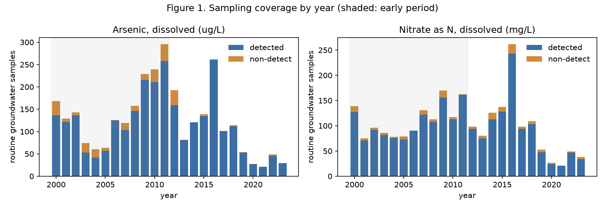
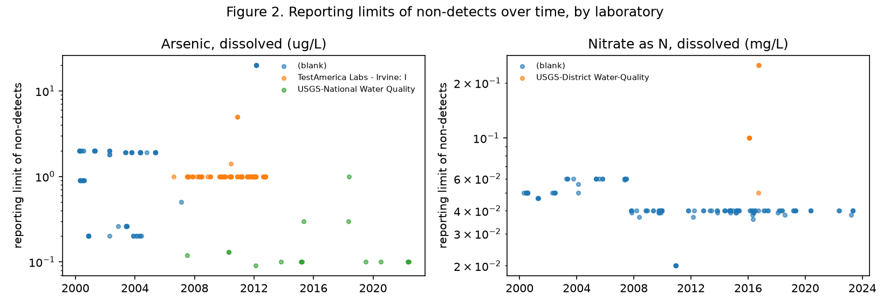
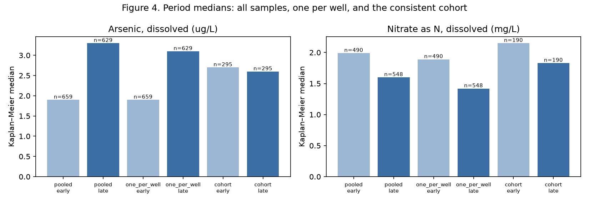
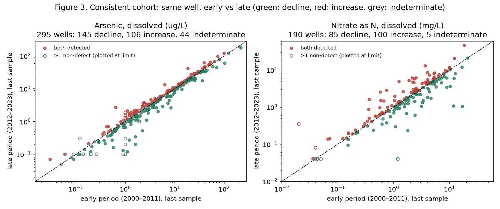

# Groundwater Audit: reference analysis report

Question: *Did measured concentrations of dissolved arsenic and of dissolved
nitrate decline at repeatedly sampled wells in San Bernardino County,
California, between 2000–2011 and 2012–2023?*

This report is generated by `python -m gwaudit.report` from `reports/results.json`.
Source data: Water Quality Portal snapshot described in `data/raw/manifest.json`
(USGS NWIS records, 13301 result rows, downloaded 2026-10-07).

## 1. What was kept and what was excluded

| Step | Rule | Rows before | Rows after | Removed |
|---|---|---|---|---|
| medium | ActivityMediaName == 'Water' and ActivityMediaSubdivisionName == 'Groundwater' | 13301 | 11748 | 1553 |
| activity_type | ActivityTypeCode == 'Sample-Routine' (replicates kept separately) | 11748 | 11093 | 655 |
| derived_duplicates | drop USGS pcodes 71851/71850: NWIS-computed re-expression of 00618/00620 in NO3 units | 11093 | 8678 | 2415 |
| analysis_subset | keep primary pcodes (01000 arsenic dissolved, 00618 nitrate as N dissolved, 00631 NO3+NO2 as N dissolved); other fractions kept in results_clean only | 8678 | 7733 | 945 |

Non-groundwater media removed: {'Leachate': 699, 'Elutriation': 385, 'Soil moisture': 368, 'Interstitial': 98, 'Bulk deposition': 3}. Activity types removed:
{'Not determined': 73, 'Quality Control Sample-Reference Material': 4} (field replicates, 578 rows, are kept
separately for precision). The nitrate rows reported in "mg/l asNO3" (USGS code
71851) are NWIS re-expressions of the "mg/l as N" rows (00618): on
2169 paired activities the ratio is
4.3636–4.4722
(expected 4.4266, deviations are rounding), so they were dropped rather
than converted and double counted. Nitrate-plus-nitrite (00631) is a different
chemical definition and was kept as a separate family; it never occurs without
00618 in this snapshot, so it was not needed for the trend question.

## 2. Coverage

| Constituent | Routine samples | Wells | Wells with 1 / 2 / 3–5 / 6+ samples | Dates | Non-detects | Detected rows with no limit |
|---|---|---|---|---|---|---|
| Arsenic (dissolved, µg/L) | 2997 | 993 | 472 / 169 / 195 / 157 | 2000-03-28 to 2023-05-05 | 245 (8.2%) | 369 |
| Nitrate as N (dissolved, mg/L) | 2435 | 848 | 456 / 157 / 119 / 116 | 2000-03-28 to 2023-10-14 | 140 (5.8%) | 2180 |

Most wells were sampled once. The median spacing between repeat samples at
the same well is 368 days for arsenic and
378 days for nitrate. Result status is
"Preliminary" for 1190 arsenic rows and
1210 nitrate rows; these are USGS records not yet
through final review and are retained with that flag. Arsenic analyses moved from an
unnamed laboratory (2000–2006) to a contract laboratory (2005–2012) and the USGS
National Water Quality Laboratory (2007 onward); the reporting limit for non-detects
fell from about 1.9 µg/L before 2006 to
0.1 µg/L after 2012 (Figure 2).

Metadata gaps: 369 detected arsenic rows and
2180 detected nitrate rows carry no reporting limit;
64 arsenic rows have no sample time; most field replicates cannot be
paired with a routine sample on the same date in this snapshot (arsenic: 15 pairs,
nitrate: 11 pairs), so laboratory-plus-field precision is only roughly known
(median relative percent difference 24.0% for arsenic,
8.31% for nitrate).

## 3. Target quantity and unit of analysis

For each constituent: the direction and size of change in observed dissolved
concentration *at the same well* between the early period (2000–2011) and the
late period (2012–2023), using the last routine groundwater sample of each
period, over wells sampled in both periods (the consistent cohort). The
independent unit is the well. Non-detects are intervals [0, limit]; a change is
called only when the two intervals do not overlap. Medians are Kaplan–Meier
(KM) estimates that use the limits without substitution.

## 4. Pooled summaries versus the consistent cohort

### Arsenic (µg/L)

| Summary | Early wells | Early n | Early KM median | Late wells | Late n | Late KM median |
|---|---|---|---|---|---|---|
| All samples (pooled) | 659 | 1805 | 1.90 | 629 | 1192 | 3.30 |
| One sample per well | 659 | 659 | 1.90 | 629 | 629 | 3.10 |
| Consistent cohort | 295 | 295 | 2.70 | 295 | 295 | 2.60 |

### Nitrate as N (mg/L)

| Summary | Early wells | Early n | Early KM median | Late wells | Late n | Late KM median |
|---|---|---|---|---|---|---|
| All samples (pooled) | 490 | 1337 | 1.99 | 548 | 1098 | 1.60 |
| One sample per well | 490 | 490 | 1.89 | 548 | 548 | 1.42 |
| Consistent cohort | 190 | 190 | 2.15 | 190 | 190 | 1.83 |

The pooled arsenic median rises from 1.90 to
3.30 µg/L, and the pooled nitrate median falls from
1.99 to 1.60 mg/L.
Neither is a change at wells: only 295 of the arsenic wells and
190 of the nitrate wells appear in both periods, and the
cohort medians are nearly unchanged (2.70 to
2.60 µg/L; 2.15 to
1.83 mg/L). The pooled differences reflect which
wells were sampled in each period (the late period includes more high-arsenic
wells and more low-nitrate wells), not a change in the water at any well.

## 5. Within-well change in the consistent cohort

### Arsenic

- Cohort wells: 295 (median 6.6 years between the two samples).
- Direction of change, same well: **145 decline, 106 increase, 44 indeterminate** (indeterminate means at least one of the two results is a non-detect whose interval overlaps the other).
- Share declining among the 251 determinate wells: 0.578 (exact binomial 95% CI 0.514–0.639; sign test p = 0.016).
- Share declining among all cohort wells: 0.491 (well-level bootstrap 95% CI 0.434–0.549, 2000 resamples, seed 20261007).
- Among the 257 wells with both results detected, the median late/early ratio is 0.967 (Wilcoxon signed-rank p = 0.002).
- Substitution sensitivity (share declining if non-detects are set to zero / half the limit / the limit): 0.502 / 0.515 / 0.512.

### Nitrate as N

- Cohort wells: 190 (median 8.12 years between the two samples).
- Direction of change, same well: **85 decline, 100 increase, 5 indeterminate** (indeterminate means at least one of the two results is a non-detect whose interval overlaps the other).
- Share declining among the 185 determinate wells: 0.460 (exact binomial 95% CI 0.386–0.534; sign test p = 0.303).
- Share declining among all cohort wells: 0.447 (well-level bootstrap 95% CI 0.379–0.516, 2000 resamples, seed 20261007).
- Among the 180 wells with both results detected, the median late/early ratio is 1.021 (Wilcoxon signed-rank p = 0.612).
- Substitution sensitivity (share declining if non-detects are set to zero / half the limit / the limit): 0.447 / 0.468 / 0.468.

Per-well monotonic trend (interval-aware Kendall S) for wells with six or more
samples: arsenic 157 wells, 20 with tau ≤ −0.5 and
10 with tau ≥ 0.5 (median tau -0.067); nitrate 116 wells,
19 with tau ≤ −0.5 and 24 with tau ≥ 0.5 (median tau -0.019).

## 6. Interpretation

**Nitrate.** At the 190 wells sampled in both periods, declines
(85) and increases (100) are about equally common and
the median within-well ratio is 1.02. The data do not
support a decline in measured nitrate at repeatedly sampled wells. The lower pooled
median in the late period is a change in which wells were sampled.

**Arsenic.** At the 295 cohort wells, declines outnumber increases
(145 vs 106, sign test p = 0.016) and the
median within-well ratio among detected pairs is 0.967, a
change of about 3%. This shift is statistically
detectable but small: it is well inside the replicate precision of the measurements
(median relative percent difference 24.0% on 15 pairs), the
laboratory and reporting limit changed between the periods, and
44 wells cannot be classified because an early non-detect at 1–2 µg/L
overlaps the late result. The defensible statement is that measured arsenic at the
cohort wells was, on average, slightly lower in the late period, by an amount
comparable to measurement variability, with no evidence of a widespread decline.

Neither result supports a statement about remediation, basin-wide improvement,
or health risk. The cohort is the set of wells the USGS and the Mojave Water
Agency chose to resample, which is not a random sample of wells in the county.

## 7. Limitations attached to these claims

- Most wells have one sample; the cohort is a minority of wells and its selection is not documented in the snapshot.
- The early period is dominated by one contract laboratory for 2005–2012 and the reporting limit changed by an order of magnitude; a method shift could produce a small apparent change.
- Replicate pairing is largely unavailable, so precision is estimated from a handful of pairs.
- Period summaries use one sample per well per period; within-period variability at a well is not used.
- "Preliminary" USGS records are included; final review could change individual values.
